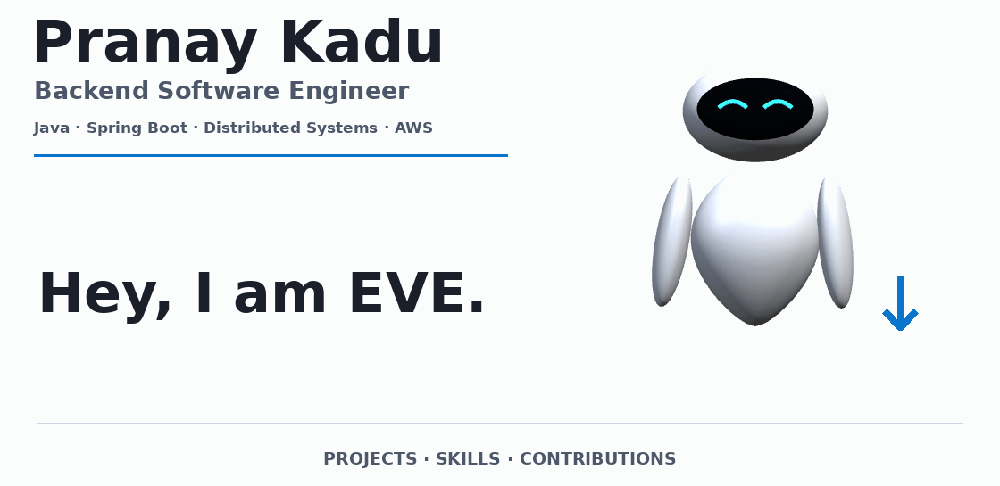

<!-- GitHub profile · BackendArchitectX -->

<!-- Animated 3D EVE: one moving fin waves and points; other fin stationary; five languages -->
<picture>
  <source media="(prefers-reduced-motion: reduce) and (prefers-color-scheme: dark)" srcset="./assets/eve-readme-v4-dark-still.png" />
  <source media="(prefers-reduced-motion: reduce)" srcset="./assets/eve-readme-v4-light-still.png" />
  <source media="(prefers-color-scheme: dark)" srcset="./assets/eve-readme-v4-dark.gif" />
  
</picture>

  
  
  
  

# Pranay Kadu

**Backend Software Engineer | Java · Spring Boot · Distributed Systems · AWS**

I build and troubleshoot backend systems where **transaction correctness, concurrency, performance, and failure recovery** matter. My primary work spans Spring Boot services, event-driven architecture, data-intensive APIs, and AWS-based delivery. I also build across the full stack when the problem calls for it.

[LinkedIn](https://www.linkedin.com/in/pranaykadu) · [Engineering portfolio](https://backendarchitectx.github.io/) · [Email](mailto:pranaykadu.softwareengineer@gmail.com) · [All repositories](https://github.com/BackendArchitectX?tab=repositories)

## Professional engineering

**Software Engineer at Linux Socials (Apr 2025–present)** · Previously, **Merkle Inspire** (2021–2024).

Selected backend engineering case studies from my [portfolio](https://backendarchitectx.github.io/):

- **[Fraud screening microservice](https://github.com/BackendArchitectX/BackendArchitectX.github.io/blob/main/work/fraud-screening.html)** — Java/Spring Boot, idempotent request handling, Redis lookups, bounded rate limiting, circuit breakers, and incident observability.
- **[Financial transaction workflows](https://github.com/BackendArchitectX/BackendArchitectX.github.io/blob/main/work/financial-workflow.html)** — Spring transactions, isolation levels, optimistic locking, SQL/index tuning, cursor pagination, and caching.
- **[Job-feed integration portal](https://github.com/BackendArchitectX/BackendArchitectX.github.io/blob/main/work/job-feed.html)** — React + Spring Boot, parallel external API calls, bounded retries, batch persistence, and cache-backed refreshes.

**Selected outcomes documented in my portfolio:** 40% lower p95 latency from profiling and persistence-path tuning, and mean time to recovery reduced from 35 to 12 minutes through operational improvements. These describe specific production work, not general benchmarks.

## Selected public projects

- **[NUMEN](https://github.com/BackendArchitectX/NUMEN)** — Java-backed data-intelligence workflows that collect from **explicitly permitted public sources**, preserve provenance, validate records, and run via Docker Compose. Focus: auditable data flow, failure visibility, and one-step startup.
- **[Aegis Insurance Decisioning](https://github.com/BackendArchitectX/Aegis-Insurance-Decision-Platform)** — Simulated insurance operations with a **Java/Spring Boot backend**, **Angular frontend**, risk-rule decisions, and audit trails. The documented demo uses an in-memory data store.
- **[Vortex CUDA](https://github.com/BackendArchitectX/Vortex-CUDA)** — Exact GPU vector search spanning CUDA, C++20, Java JNI, and Spring Boot. On the documented RTX 3050 workload, the project reports **48/48 benchmark validations**, **50% less FP16 vector storage**, and **~16.7× lower p50 latency vs its own scalar CPU reference**—not a production vector database. [Methodology](https://github.com/BackendArchitectX/Vortex-CUDA/blob/main/docs/BENCHMARKS.md) · [Hardware and repeated-run evidence](https://github.com/BackendArchitectX/Vortex-CUDA/blob/main/docs/LIVE_BENCHMARK_RTX3050.md).

**More engineering experiments:** [BedRock](https://github.com/BackendArchitectX/BedRock) (early Go orchestration prototype with verification and rollback) · [CHAIN//REACTION](https://github.com/BackendArchitectX/CHAIN-REACTION) (synthetic causal-resilience simulation) · [Distributed transaction lab](https://github.com/BackendArchitectX/distrib-txn-db) (fork; MVCC and clock/conflict experiments).

## Open-source contributions

I make focused, testable changes around **lifecycle correctness, concurrency, RPC behavior, and CI reliability**.

**8 externally merged PRs** across 5 upstream repositories: **5 engineering changes** and **3 developer-domain configuration changes**. Only pull requests authored by [BackendArchitectX](https://github.com/BackendArchitectX) and verified as merged into repositories outside my account are included in this count.

### Merged upstream — engineering (5)

- **[Apache Fluss #4263](https://github.com/apache/fluss/pull/4263)** — Made RPC connection caching endpoint-aware to handle server address changes safely during rolling upgrades.
- **[Apache Pulsar #26969](https://github.com/apache/pulsar/pull/26969)** — Indexed topic-watcher notifications by namespace to avoid unnecessary checks of unrelated listeners.
- **[Apache Druid #20633](https://github.com/apache/druid/pull/20633)** — Preserved user-input error classification when errors propagate from data servers.
- **[AutoMQ #3542](https://github.com/AutoMQ/automq/pull/3542)** — Clarified callback ownership and removed redundant topic-cleanup traversal.
- **[AutoMQ #3493](https://github.com/AutoMQ/automq/pull/3493)** — Prevented AutoBalancer metrics reporting from starting on controller-only nodes.

### Other merged external PRs — developer-domain setup (3)

- **[is-a-dev/register #57221](https://github.com/is-a-dev/register/pull/57221)** — Registered `pranaykadu.is-a.dev`.
- **[is-a-dev/register #57294](https://github.com/is-a-dev/register/pull/57294)** — Added GitHub Pages TXT verification for the domain.
- **[is-a-dev/register #57318](https://github.com/is-a-dev/register/pull/57318)** — Corrected the domain contact email.

### Open upstream proposals

- **[Trino #30973](https://github.com/trinodb/trino/pull/30973)** — Coordinate query failure with autocommit transaction-commit ownership.
- **[Apache Pinot #19915](https://github.com/apache/pinot/pull/19915)** — Improve hash distribution in replica-group instance lookups.
- **[AutoMQ #3579](https://github.com/AutoMQ/automq/pull/3579)** — Optional Basic authentication for the Prometheus metrics endpoint.
- **[AutoMQ #3555](https://github.com/AutoMQ/automq/pull/3555)** — Prevent in-flight block restoration after a stream reader closes.
- **[Nasiko #343](https://github.com/Nasiko-Labs/nasiko/pull/343)** — Fix Windows queue-write failure reporting.

*GitHub PR status verified on November 2, 2026. Internal/fork-only merges are excluded from the external contribution count.*

### Documented investigation

**[DJV #919](https://github.com/grizzlypeak3d/DJV/pull/919)** — Investigated Information-panel search and [identified a PR CI test-discovery gap](https://github.com/grizzlypeak3d/DJV/pull/919#issuecomment-6128335336). The maintainer independently applied [search](https://github.com/grizzlypeak3d/DJV/commit/2e67a2401d2704ac7005f8c4685c3f1d9f2c7a5b) and [workflow](https://github.com/grizzlypeak3d/DJV/commit/d249d10cb9832779cc8e3ea30e5cf8fca3c77bdb) updates. **My PR was closed without merging and is not counted above.**

## Technical expertise

**Core strengths:** Java 8/11/17 · Spring Boot · Microservices · Distributed Systems · AWS · Kafka · SQL · Redis

- **Java & backend:** Java/J2EE, Collections, Streams, multithreading, Spring MVC, Spring Data JPA, Hibernate/JPA, Spring Security, JSP/Servlets, REST APIs, DTOs, validation, OpenAPI/Swagger, Postman.
- **Architecture & messaging:** Kafka, IBM MQ, RabbitMQ, asynchronous processing, transactional boundaries, idempotency, rate limiting, retries/backoff, circuit breakers, caching, SOLID, design patterns.
- **AWS & DevOps:** EC2, EKS, RDS, S3, CloudWatch, Docker, Kubernetes, PCF, Jenkins, GitHub Actions, Maven, Gradle, Git, GitHub/GitLab/Bitbucket.
- **Data & observability:** MySQL, PostgreSQL, Oracle SQL, Redis, SQL tuning, indexing, pagination, optimistic locking, JFR/JVM profiling, Splunk, Dynatrace, Grafana, logging, metrics, incident investigation.
- **Full-stack:** React, TypeScript, JavaScript, HTML5, CSS3, JSP, Angular (project experience), and Java-to-frontend API integration.
- **Security & quality:** OAuth2/JWT, authentication/authorization, JUnit 5, Mockito, TDD, unit/integration testing, regression tests, negative-path tests, CI/CD and code reviews.
- **Additional tools & languages:** Python, C++; FastAPI/Flask, Node.js/Express and MongoDB (working exposure); Go (learning through prototypes); GitHub Copilot, Cursor, Claude and AI-assisted workflows with human review.

## Engineering approach

> **Build for failure. Measure before optimizing. Preserve the invariant.**

I favor explicit ownership, simple designs, reproducible tests, and performance claims supported by workload-specific evidence.

**Open to backend engineering opportunities and thoughtful open-source collaboration.**

[GitHub contribution activity](https://github.com/BackendArchitectX) · [Portfolio](https://backendarchitectx.github.io/) · [LinkedIn](https://www.linkedin.com/in/pranaykadu) · [Contact](mailto:pranaykadu.softwareengineer@gmail.com)

