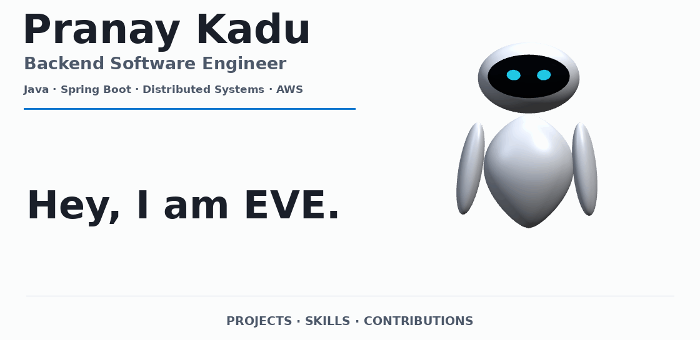

<!-- GitHub profile · BackendArchitectX -->

<!-- Animated 3D EVE: one hand waves and points down; five languages -->
<picture>
  <source media="(prefers-reduced-motion: reduce) and (prefers-color-scheme: dark)" srcset="./assets/eve-readme-v7-dark-still.png" />
  <source media="(prefers-reduced-motion: reduce)" srcset="./assets/eve-readme-v7-light-still.png" />
  <source media="(prefers-color-scheme: dark)" srcset="./assets/eve-readme-v7-dark.gif" />
  
</picture>

  
  
  
  

# Pranay Kadu

**Backend Software Engineer | Java · Spring Boot · Distributed Systems · AWS**

I build and troubleshoot backend systems where **transaction correctness, concurrency, performance, and failure recovery** matter. My primary work spans Spring Boot services, event-driven architecture, data-intensive APIs, and AWS-based delivery. I also build across the full stack when the problem calls for it.

[LinkedIn](https://www.linkedin.com/in/pranaykadu) · [Engineering portfolio](https://backendarchitectx.github.io/) · [Email](mailto:pranaykadu.softwareengineer@gmail.com) · [All repositories](https://github.com/BackendArchitectX?tab=repositories)

## Professional engineering

**Software Engineer at Linux Socials (Apr 2025–present)** · Previously, **Merkle Inspire** (2021–2024).

Selected backend engineering case studies from my [portfolio](https://backendarchitectx.github.io/):

- **[Fraud screening microservice](https://github.com/BackendArchitectX/BackendArchitectX.github.io/blob/main/work/fraud-screening.html)** — Java/Spring Boot, idempotent request handling, Redis lookups, bounded rate limiting, circuit breakers, and incident observability.
- **[Financial transaction workflows](https://github.com/BackendArchitectX/BackendArchitectX.github.io/blob/main/work/financial-workflow.html)** — Spring transactions, isolation levels, optimistic locking, SQL/index tuning, cursor pagination, and caching.
- **[Job-feed integration portal](https://github.com/BackendArchitectX/BackendArchitectX.github.io/blob/main/work/job-feed.html)** — React + Spring Boot, parallel external API calls, bounded retries, batch persistence, and cache-backed refreshes.

**Selected outcomes documented in my portfolio:** 40% lower p95 latency from profiling and persistence-path tuning, and mean time to recovery reduced from 35 to 12 minutes through operational improvements. These describe specific production work, not general benchmarks.

## Selected public projects

- **[NUMEN](https://github.com/BackendArchitectX/NUMEN)** — Java-backed data-intelligence workflows that collect from **explicitly permitted public sources**, preserve provenance, validate records, and run via Docker Compose. Focus: auditable data flow, failure visibility, and one-step startup.
- **[Aegis Insurance Decisioning](https://github.com/BackendArchitectX/Aegis-Insurance-Decision-Platform)** — Simulated insurance operations with a **Java/Spring Boot backend**, **Angular frontend**, risk-rule decisions, and audit trails. The documented demo uses an in-memory data store.
- **[Vortex CUDA](https://github.com/BackendArchitectX/Vortex-CUDA)** — Exact GPU vector search spanning CUDA, C++20, Java JNI, and Spring Boot. On the documented RTX 3050 workload, the project reports **48/48 benchmark validations**, **50% less FP16 vector storage**, and **~16.7× lower p50 latency vs its own scalar CPU reference**—not a production vector database. [Methodology](https://github.com/BackendArchitectX/Vortex-CUDA/blob/main/docs/BENCHMARKS.md) · [Hardware and repeated-run evidence](https://github.com/BackendArchitectX/Vortex-CUDA/blob/main/docs/LIVE_BENCHMARK_RTX3050.md).

**More engineering experiments:** [BedRock](https://github.com/BackendArchitectX/BedRock) (early Go orchestration prototype with verification and rollback) · [CHAIN//REACTION](https://github.com/BackendArchitectX/CHAIN-REACTION) (synthetic causal-resilience simulation) · [Distributed transaction lab](https://github.com/BackendArchitectX/distrib-txn-db) (fork; MVCC and clock/conflict experiments).

## Open-source contributions

**5 merged engineering PRs across 4 external upstream projects** — Apache Fluss, Apache Pulsar, Apache Druid, and AutoMQ. I focus on correctness, concurrency, performance-sensitive dispatch, and failure recovery. Only merged code contributions authored by [BackendArchitectX](https://github.com/BackendArchitectX) are included here; repository-local and domain-registration PRs are excluded.

### Merged upstream engineering

- **[Apache Fluss · RPC endpoint correctness (#4263)](https://github.com/apache/fluss/pull/4263)** — *Problem:* caching connections by server UID alone could reuse an outdated endpoint after a host/port change. *Change:* keyed connections by UID, host, and port; made readiness and disconnect operations endpoint-aware. Added regression tests for rolling-upgrade and connection-lifecycle behavior.
- **[Apache Pulsar · Namespace-indexed topic watchers (#26969)](https://github.com/apache/pulsar/pull/26969)** — *Problem:* topic notifications scanned listeners registered for unrelated namespaces. *Change:* indexed persistent-topic watchers by namespace and dispatched callbacks outside the registration lock. Added concurrency and listener-lifecycle tests plus a JMH comparison with the original linear scan.
- **[Apache Druid · Preserve user error classifications (#20633)](https://github.com/apache/druid/pull/20633)** — *Problem:* errors from data servers could lose their `INVALID_INPUT` / user-error classification. *Change:* preserved exception causes in multithreaded groupBy execution and reconstructed structured `DruidException` responses while retaining legacy compatibility. Added regression tests across both paths.
- **[AutoMQ · Remove redundant topic cleanup (#3542)](https://github.com/AutoMQ/automq/pull/3542)** — *Problem:* duplicate deleted-topic traversal produced redundant coordinator cleanup notifications. *Change:* removed the extra traversal, retaining callbacks for actual partition deletion and state transitions.
- **[AutoMQ · Controller-only metrics startup (#3493)](https://github.com/AutoMQ/automq/pull/3493)** — *Problem:* metrics-reporter initialization could run on controller-only processes. *Change:* skipped broker-only configuration, producers, and reporter threads when the broker role is absent; covered broker, controller, and combined-role cases.

### Active upstream reviews

**Distributed systems:** [Trino #30973](https://github.com/trinodb/trino/pull/30973) (transaction-commit race) · [Apache Pinot #19915](https://github.com/apache/pinot/pull/19915) (replica-group lookup hashing) · [Apache Fluss #4230](https://github.com/apache/fluss/pull/4230) (custom Paimon lake-table paths).

**Reliability and security:** [AutoMQ #3579](https://github.com/AutoMQ/automq/pull/3579) (Prometheus Basic authentication) · [AutoMQ #3555](https://github.com/AutoMQ/automq/pull/3555) (reader-close lifecycle) · [Nasiko #343](https://github.com/Nasiko-Labs/nasiko/pull/343) (Windows queue writes).

*PR statuses verified November 2, 2026. Open proposals are not counted as merged contributions.*

## Technical expertise

**Core strengths:** Java 8/11/17 · Spring Boot · Microservices · Distributed Systems · AWS · Kafka · SQL · Redis

- **Java & backend:** Java/J2EE, Collections, Streams, multithreading, Spring MVC, Spring Data JPA, Hibernate/JPA, Spring Security, JSP/Servlets, REST APIs, DTOs, validation, OpenAPI/Swagger, Postman.
- **Architecture & messaging:** Kafka, IBM MQ, RabbitMQ, asynchronous processing, transactional boundaries, idempotency, rate limiting, retries/backoff, circuit breakers, caching, SOLID, design patterns.
- **AWS & DevOps:** EC2, EKS, RDS, S3, CloudWatch, Docker, Kubernetes, PCF, Jenkins, GitHub Actions, Maven, Gradle, Git, GitHub/GitLab/Bitbucket.
- **Data & observability:** MySQL, PostgreSQL, Oracle SQL, Redis, SQL tuning, indexing, pagination, optimistic locking, JFR/JVM profiling, Splunk, Dynatrace, Grafana, logging, metrics, incident investigation.
- **Full-stack:** React, TypeScript, JavaScript, HTML5, CSS3, JSP, Angular (project experience), and Java-to-frontend API integration.
- **Security & quality:** OAuth2/JWT, authentication/authorization, JUnit 5, Mockito, TDD, unit/integration testing, regression tests, negative-path tests, CI/CD and code reviews.
- **Additional tools & languages:** Python, C++; FastAPI/Flask, Node.js/Express and MongoDB (working exposure); Go (learning through prototypes); GitHub Copilot, Cursor, Claude and AI-assisted workflows with human review.

## Engineering approach

> **Build for failure. Measure before optimizing. Preserve the invariant.**

I favor explicit ownership, simple designs, reproducible tests, and performance claims supported by workload-specific evidence.

[Engineering investigation notes](docs/engineering-notes.md) — CI test discovery and search semantics, documented separately from merged upstream contributions.

**Open to backend engineering opportunities and thoughtful open-source collaboration.**

[GitHub contribution activity](https://github.com/BackendArchitectX) · [Portfolio](https://backendarchitectx.github.io/) · [LinkedIn](https://www.linkedin.com/in/pranaykadu) · [Contact](mailto:pranaykadu.softwareengineer@gmail.com)

