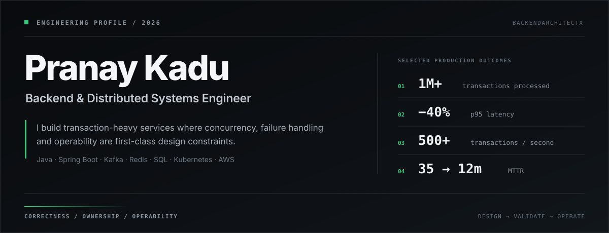

<!-- GitHub profile · BackendArchitectX · verified October 2026 -->

  

# Hi, I'm Pranay Kadu 👋

**Backend Software Engineer · Java & Spring Boot · Distributed Systems · Reliability**

I build backend services where **correctness under concurrency, predictable failure recovery, and measurable performance** matter as much as the happy path. My interests include transactional workflows, event-driven services, JVM tuning, and fault-tolerant infrastructure.

  <a href="https://www.linkedin.com/in/pranaykadu">LinkedIn</a> ·
  <a href="https://backendarchitectx.github.io/">Portfolio</a> ·
  <a href="mailto:pranaykadu.softwareengineer@gmail.com">Email</a> ·
  <a href="https://github.com/BackendArchitectX?tab=repositories">All repositories</a>

## Selected engineering work

- **[Vortex CUDA](https://github.com/BackendArchitectX/Vortex-CUDA)** — Exact GPU vector search built with CUDA, C++20, Java JNI, and Spring Boot. Includes persistent indexes, batched Top-K kernels, FP16 storage, and reproducible benchmarks.
- **[NUMEN](https://github.com/BackendArchitectX/NUMEN)** — Java-backed data-intelligence workflows covering permitted-source collection, record validation, provenance, and a web interface.
- **[Aegis Insurance Decisioning](https://github.com/BackendArchitectX/Aegis-Insurance-Decision-Platform)** — Full-stack insurance workflows for policy servicing, premium rating, claims, renewals, and auditable decisions.
- **[BedRock](https://github.com/BackendArchitectX/BedRock)** — *Early Go prototype* for local-first AI-assisted software engineering with bounded changes, explicit verification, and rollback; not production-ready.
- **[CHAIN//REACTION](https://github.com/BackendArchitectX/CHAIN-REACTION)** — Local-first, **synthetic** infrastructure-resilience simulation with causal dependencies, counterfactual scenarios, and deterministic safety checks.

**Systems learning:** [Distributed transaction lab (fork)](https://github.com/BackendArchitectX/distrib-txn-db) — experimenting with MVCC, hybrid logical clocks, conflicts, and failure interleavings.

### Measured work, with context

Vortex CUDA's documented RTX 3050 laptop GPU experiments on **500,000 × 128-dimensional vectors** report:

| Result | What was measured |
| --- | --- |
| **48/48** | Benchmark validation cases passed |
| **50%** | FP16 vector-storage reduction relative to FP32 |
| **~16.7× lower P50 latency** | Fused exact GPU Top-K vs **this project's scalar CPU reference**, not a production vector database |

[Benchmark methodology](https://github.com/BackendArchitectX/Vortex-CUDA/blob/main/docs/BENCHMARKS.md) · [Hardware and repeated-run results](https://github.com/BackendArchitectX/Vortex-CUDA/blob/main/docs/LIVE_BENCHMARK_RTX3050.md). Results are workload- and hardware-specific; FP16 is not universally faster.

## Open-source engineering

I contribute fixes and investigations around concurrency, lifecycle boundaries, RPC identity, transaction ownership, and CI correctness.

### Merged upstream

- **[AutoMQ #3493](https://github.com/AutoMQ/automq/pull/3493)** — Prevented metrics reporting from starting on controller-only nodes.
- **[AutoMQ #3542](https://github.com/AutoMQ/automq/pull/3542)** — Clarified callback responsibility and removed redundant topic cleanup logic.

### Open proposals

- **[Trino #30973](https://github.com/trinodb/trino/pull/30973)** — Commit/failure ownership around autocommit query completion.
- **[Apache Fluss #4263](https://github.com/apache/fluss/pull/4263)** — Endpoint-aware caching for RPC connections when tablet-server addresses change.
- **[AutoMQ #3579](https://github.com/AutoMQ/automq/pull/3579)** — Optional Basic authentication for the Prometheus metrics endpoint.
- **[AutoMQ #3555](https://github.com/AutoMQ/automq/pull/3555)** — Guarding stream-reader state against late asynchronous block restoration.
- **[Nasiko #343](https://github.com/Nasiko-Labs/nasiko/pull/343)** — Avoiding false queue-write failure reports on Windows.

*PR statuses checked on October 12, 2026; follow each link for its current state.*

### Investigation adopted independently upstream

**[DJV #919](https://github.com/grizzlypeak3d/DJV/pull/919)** — Investigated Information-panel search, wrote regression tests and GUI evidence, and identified a PR workflow that could pass without executing tests. The maintainer [acknowledged the CI finding](https://github.com/grizzlypeak3d/DJV/pull/919#issuecomment-6128335336) and implemented [a smaller search change](https://github.com/grizzlypeak3d/DJV/commit/2e67a2401d2704ac7005f8c4685c3f1d9f2c7a5b) plus [the workflow fix](https://github.com/grizzlypeak3d/DJV/commit/d249d10cb9832779cc8e3ea30e5cf8fca3c77bdb) directly on `main`. **PR #919 was closed without merging.**

## Technical expertise

**Core stack:** Java 8/11/17 · Spring Boot · Spring MVC · Microservices · REST APIs · Kafka · SQL · Redis · AWS · Docker · Kubernetes

| Engineering area | Technologies, frameworks and practices |
| --- | --- |
| **Programming languages** | **Java**, SQL, Python, C++, JavaScript, TypeScript; Go (currently exploring) |
| **Java & JVM ecosystem** | Core Java, J2EE, OOP, Collections, Streams, multithreading, concurrency, functional programming, exception handling, Java 8/11/17 |
| **Backend frameworks** | **Spring Boot**, Spring MVC, Spring Data JPA, Hibernate/JPA, Spring Security (OAuth2/JWT), JSP/Servlets; FastAPI, Flask and Node.js/Express (working exposure) |
| **Frontend & full-stack** | **React**, JavaScript, TypeScript, HTML5, CSS3, JSP; Angular fundamentals; integrating React applications with Java/Spring Boot APIs |
| **APIs & integration** | RESTful APIs, HTTP, JSON, XML, DTOs, validation, exception handling, Swagger/OpenAPI, Postman, service integration |
| **Microservices & messaging** | Microservices, event-driven architecture, **Apache Kafka**, IBM MQ, RabbitMQ, asynchronous workflows, message processing |
| **Databases & persistence** | **MySQL**, PostgreSQL, Oracle SQL, **Redis**, SQL optimization, indexing, transactions, isolation levels, optimistic locking; MongoDB exposure |
| **System design & reliability** | Distributed systems, SOLID, design patterns, idempotency, retry/backoff, circuit breakers, caching, rate limiting, pagination, fault tolerance, concurrency control |
| **Cloud & infrastructure** | **AWS** (EC2, EKS, S3, RDS, CloudWatch), **Docker**, **Kubernetes**, Pivotal Cloud Foundry (PCF), containerized application delivery |
| **Build, CI/CD & version control** | **Maven**, Gradle, Jenkins, GitHub Actions, CI/CD pipelines, Git, GitHub, GitLab, Bitbucket |
| **Testing & code quality** | **JUnit 5**, Mockito, unit/integration tests, TDD, regression and negative-path testing, code review, reproducible test cases |
| **Monitoring & performance** | JVM profiling, **Java Flight Recorder (JFR)**, Splunk, Dynatrace, Grafana, structured logging, metrics, alerts, root-cause analysis, p95 latency and throughput tuning |
| **Engineering collaboration** | Jira, Confluence, Agile/Scrum, API documentation, production debugging, incident investigation, technical documentation |
| **AI-assisted development** | GitHub Copilot, Cursor, Claude and other coding assistants for research, implementation and code review—with tests and manual verification |

### What I build and troubleshoot

- **Backend platforms:** Spring Boot APIs, microservices, transactional workflows, message-driven processing, caching and database-intensive services.
- **Production systems:** Performance bottlenecks, concurrency issues, integration failures, reliability improvements, observability and incident recovery.
- **End-to-end features:** React-based interfaces connected to Java APIs, data persistence, validation, automated tests and CI/CD delivery.
- **Engineering fundamentals:** Clear architecture, maintainable code, secure API patterns, deterministic regression tests and evidence-based optimization.

## Engineering principle

> **Build for failure. Measure before optimizing. Preserve the invariant.**

I prefer focused changes, explicit ownership, realistic failure tests, and claims supported by reproducible evidence.

## GitHub activity

[View activity directly on GitHub](https://github.com/BackendArchitectX) if the external chart does not load.

---

**Open to backend engineering collaboration and thoughtful open-source reviews.**

[LinkedIn](https://www.linkedin.com/in/pranaykadu) · [Portfolio](https://backendarchitectx.github.io/) · [Email](mailto:pranaykadu.softwareengineer@gmail.com)
